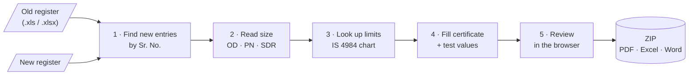
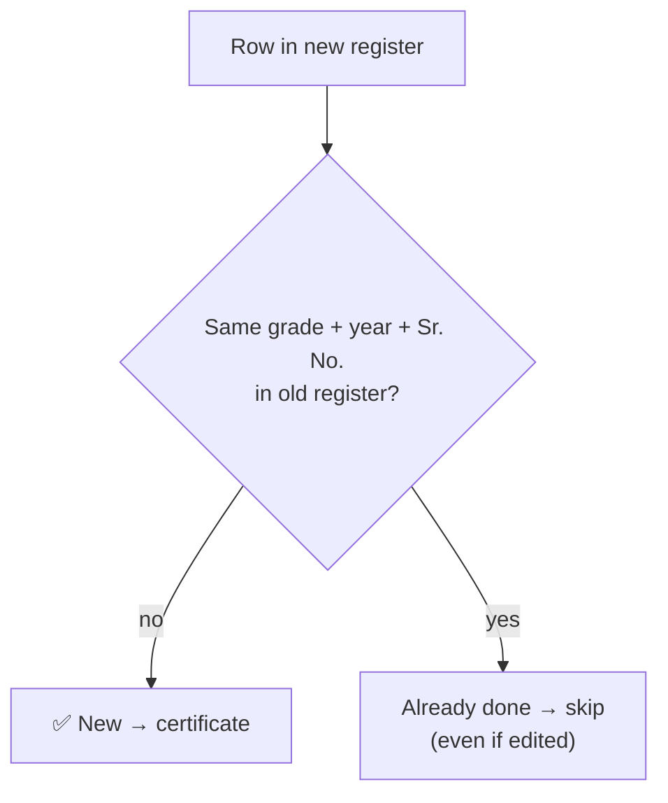
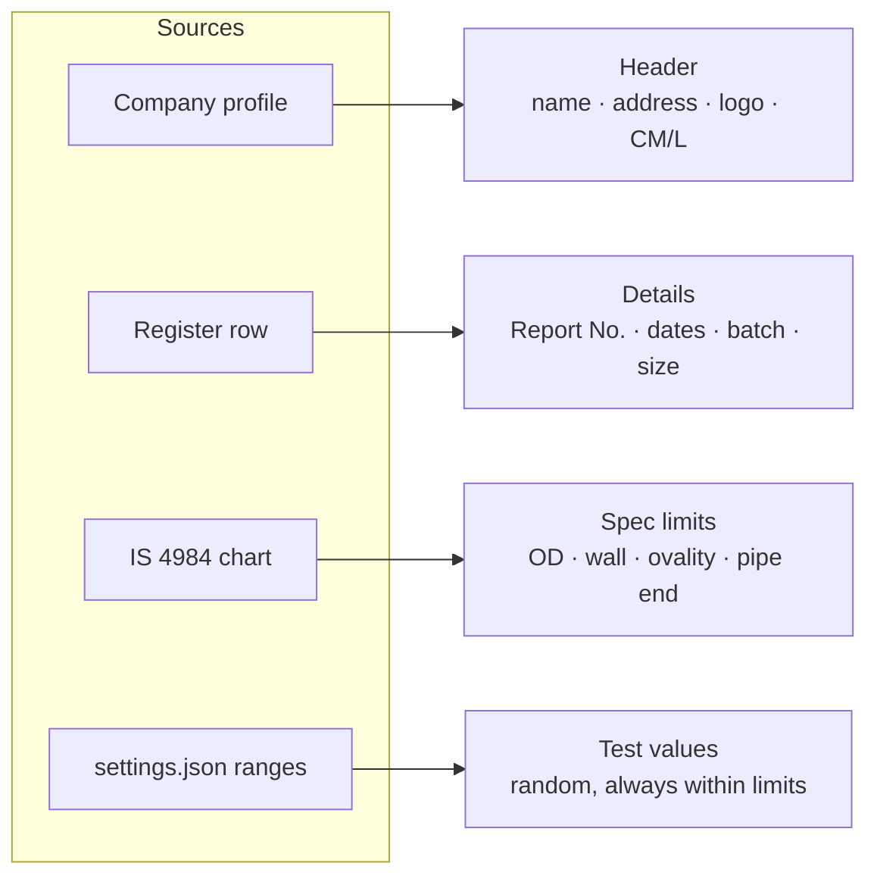
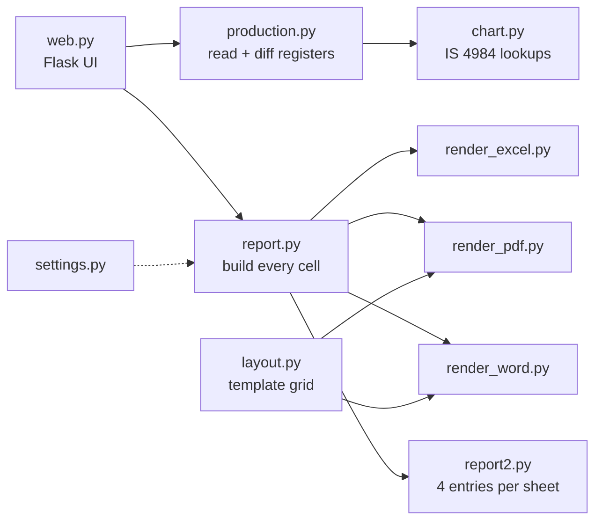

# reportGenerator

Turns a pipe factory's **production register** into **IS 4984 : 2016 HDPE pipe test certificates**, as PDF, Excel or Word.

> Upload last time's register and today's. The app finds the new entries and makes a certificate for each one.

Runs locally on one Windows PC: a small Flask web app, with no internet and no login.

---

## How it works



## Using it

| Step | Screen | What you do |
|:-:|---|---|
| 1 | **Choose files** | Pick the company, then the old and new register |
| 2 | **Check entries** | See the new entries; untick any, edit the Report No. |
| 3 | **Download** | In the side panel: Report 1 and/or 2, formats, *one file per certificate* or *one file per grade* |

The ZIP comes out sorted by grade:

```
Test certificates 2026-10-30.zip
├── PE 63/   MP63-171.pdf, MP63-171.xlsx …
├── PE 80/   …
└── PE 100/  …
```

**Report 2** (testing record) can be made instead of or with the certificates: the same entries and values, 4 side by side per sheet, all in one Excel file. An earlier, incomplete Report 2 can be uploaded so its free columns are filled first.

Rows the app can't certify (an unknown size, an empty size…) are listed with the reason, never silently dropped.

### Look

| | |
|---|---|
| **Theme** | Light: warm paper, ink, a tangerine key for the one main action, green for done |
| **Check screen** | Entries on a ruled sheet; the job sheet (tally, reports, formats, download) stays beside them |
| **Fonts** | Red Hat Display / Text / Mono, bundled in `app/static/fonts/`, so it works offline |
| **CSS** | `tokens.css` (colours, sizes) → `base.css` (shared rules) → `style.css` (the screens) |

Design notes: [docs/web-design.md](docs/web-design.md).

---

## Finding new entries



- **Key = grade + financial year + Sr. No.** (Sr. No. restarts every April).
- **Repeated Sr. No.:** each old row covers one new row, so only the extra rows count as new.
- **Sheets:** one per grade, named like `Production 63` or `PE 63`. Other sheets are ignored.
- **Columns** are found by **heading**, not by position:

| Heading | Used for |
|---|---|
| Sr. No. | identifying the row |
| Date | manufacturing date → testing dates |
| Size | `32 X 6 ( SDR 13.6 )`: the SDR part is optional |
| Report No. | report number and file name (`MP100/019` → `MP100-019.pdf`) |
| Batch Number | printed on the certificate |

---

## What goes on a certificate



All the fill rules are in [docs/report-rules.md](docs/report-rules.md).

---

## Quick start

```bash
git clone https://github.com/anant-jp2007/reportGenerator.git
cd reportGenerator
python -m pip install -r requirements.txt
python -m app.web
```

It opens at **http://127.0.0.1:5050**. On Windows you can double-click **`Start.bat`** instead.

To try it with sample data:

```bash
python tools/make_sample_registers.py samples
```

**Needs:** Windows 10/11, Python 3.10+. Excel and Word are *not* needed to run the app.

---

## Code map



| Path | What's there |
|---|---|
| `app/` | the code above |
| `app/templates/`, `app/static/` | the three screens, CSS, fonts, logo |
| `config/settings.json` | **everything editable**: companies, cells, ranges, texts, Report 2 rows |
| `templates/*.xlsx` | certificate templates (one per company header) and `report2.xlsx` |
| `data/is4984_chart.json` | the IS 4984 weight chart |
| `tools/` | template builders, chart import, sample data, comparison tools |
| `tests/` | `python tests/run_all.py` |

---

## Adding a company

1. In `config/settings.json`, copy a profile under `company.profiles`.
2. Set its `name`, header texts (by cell), `images` (logo/stamp) and `template_layout`.
3. Build its template:
   ```bash
   python tools/make_company_template.py <id>
   ```
4. Run `python tests/run_all.py`. It checks that the page still fits A4 at 100%.

Only the header changes. The table is the same for every company.

---

## Good to know

- **The three formats match.** PDF and Word are drawn from the Excel template's grid and were measured against Excel's own print, to within about 0.25 pt.
- **Settings are checked on start.** Mistakes such as min above max or overlapping ranges are reported in plain words.
- **Local only.** Uploads, output and company pictures stay on the PC and are not in this repo.
- **Limitation:** sizes of 710 mm and above have no ovality in the chart, so that value is left blank.
